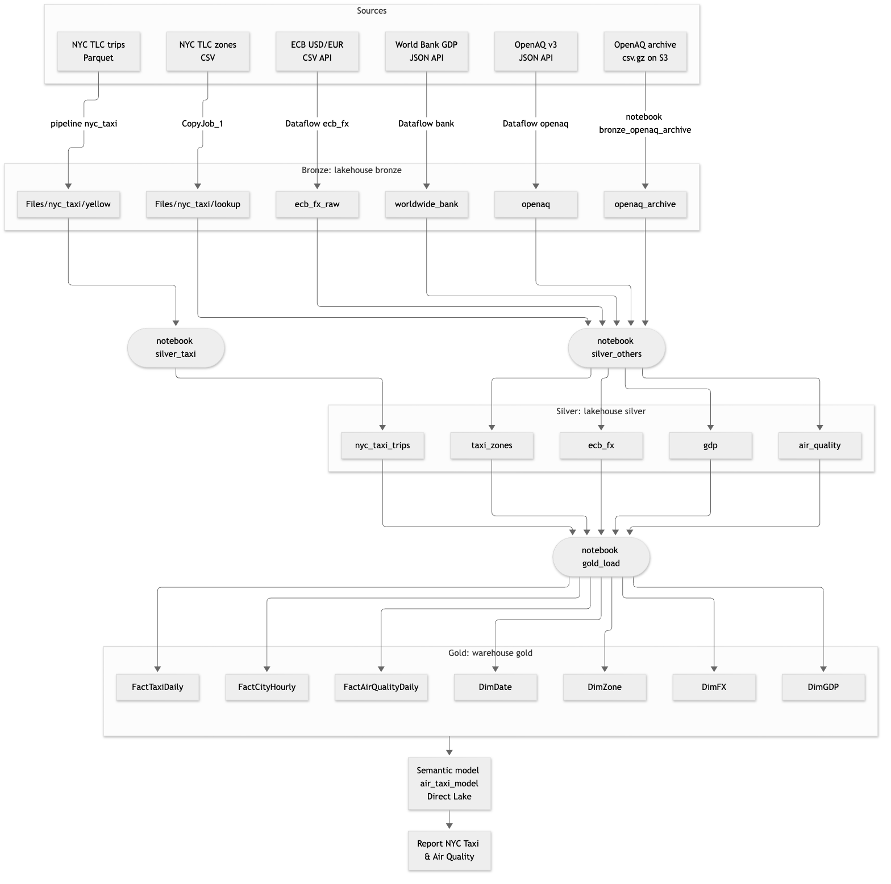

# NYC Taxi, Air Quality and Economy on Microsoft Fabric

Learning project on Microsoft Fabric. It combines NYC Yellow Taxi trips, OpenAQ air quality and economic data (ECB USD/EUR rate, World Bank US GDP) for 2023-2025 and answers the four questions from the task.

Workspace: `itransition coursework`. Capacity: F2 `kamola0708`.

## Architecture

- Bronze: lakehouse `bronze`. Raw files and tables as they come from the sources.
- Silver: lakehouse `silver`. Cleaned Delta tables, written by PySpark notebooks.
- Gold: warehouse `gold`. Star schema with 3 facts and 4 dimensions, loaded with T-SQL.
- Power BI: semantic model `air_taxi_model` (Direct Lake) and report `NYC Taxi & Air Quality` with 4 pages.
- Orchestration: pipeline `pl_main` runs all steps in order.

## Sources

| Source | Format | Loaded by | Bronze object |
|---|---|---|---|
| NYC TLC Yellow Taxi trips, 2023-2025 | Parquet, 36 monthly files | pipeline `nyc_taxi` | `Files/nyc_taxi/yellow/` |
| NYC TLC taxi zone lookup | CSV | Copy job `CopyJob_1` | `Files/nyc_taxi/lookup/` |
| ECB daily USD/EUR rate | CSV API | Dataflow `ecb_fx` | `dbo.ecb_fx_raw` |
| World Bank US GDP | JSON API | Dataflow `bank` | `dbo.worldwide_bank` |
| OpenAQ hourly PM2.5 and NO2 | JSON API v3 | Dataflow `openaq` | `dbo.openaq` |
| OpenAQ archive, Jan-Mar 2023 | csv.gz on S3 | notebook `bronze_openaq_archive` | `dbo.openaq_archive` |

## How to run

1. Resume capacity `kamola0708` in the Azure portal or with `fab start .capacities/kamola0708.Capacity`. Nothing runs while it is paused.
2. Run pipeline `pl_main` in workspace `itransition coursework`. Steps:
   - `nyc_taxi`, `zones`, `ecb_fx`, `bank`, `openaq` in parallel;
   - then `silver_taxi`, `silver_others`, `refresh_silver_endpoint`, `gold_load`, `refresh_model`.
3. Wait about 50 minutes. Each step starts only after the previous steps succeed.
4. Open report `NYC Taxi & Air Quality`.
5. Pause the capacity.

Notes:

- Pipeline parameter `year` (default `2025`) is the taxi year that `nyc_taxi` reloads.
- `pl_main` also runs every day at 10:00 Tashkent time (UTC+5) until 31 Dec 2026, but only while the capacity is running.
- `bronze_openaq_archive` is a one-time load. Run it before `silver_others` only if `bronze.dbo.openaq_archive` is missing.
- The OpenAQ API key is stored in Dataflow `openaq`. If it expires, set a new one there.
- Dataflow `openaq` often fails with a generic error. The pipeline retries it twice, 5 minutes apart.

## Folders

| Path | Content |
|---|---|
| `notebooks/` | `bronze_openaq_archive`, `silver_taxi`, `silver_others`, `gold_load` (T-SQL), `refresh_silver_endpoint`, `refresh_model` |
| `sql/` | the 14 T-SQL steps of `gold_load`, one file per cell |
| `pipelines/` | `pl_main` definition |
| `powerbi/` | semantic model (TMDL) and report (PBIR) |
| `docs/` | this file, data dictionary, lineage, governance, report PDF, all docs in one docx |

Fabric items are exported with `fab export`, edited here and loaded back with `fab import`.

## Answers to the task questions

Numbers come from the Gold tables, 2023-2025.

1. Trips per day vs PM2.5 and NO2. There is almost no link. The daily correlation is -0.05 with PM2.5 and 0.09 with NO2. On the worst wildfire smoke days (6-8 Jun 2023, PM2.5 66-139 µg/m³) there were 115-119 thousand trips a day, above the average of 109 thousand.
2. Zones and hours. A link shows up only for NO2. By hour it is strongest in the morning: 0.37 at 07:00, 0.36 at 08:00, 0.33 at 09:00. By zone (67 zones with 100,000+ trips): Lenox Hill East 0.34, Upper East Side North 0.31, Midtown East 0.30. Nightlife zones go the other way: Lower East Side -0.27, East Village -0.21. PM2.5 shows no link by zone or by hour.
3. Revenue per trip. 2023: 28.49 USD, 26.36 EUR at 1.0815 USD per EUR. 2024: 28.20 USD, 26.07 EUR at 1.0821. 2025: 28.40 USD, 25.12 EUR at 1.1300. In USD it barely moved (-0.3%). In EUR it fell 4.7% because the euro gained 4.5%.
4. Growth vs air quality. From 2023 to 2025 trips grew 19.7% (36.5 to 43.7 million) and US GDP grew 10.6% (27.81 to 30.77 trillion USD). PM2.5 fell 23% (9.79 to 7.55 µg/m³) and NO2 fell about 5% (0.0171 to 0.0162 ppm). The data does not show growth at the cost of air quality.

These are correlations, not causes. Taxi trips and NO2 both go up on weekday mornings together with all other traffic.

## Data limitations

- NO2 comes from 4 stations, all in New Jersey.
- Air stations are not linked to taxi zones. Air values are city averages.
- 20 days of 2023 have no air data (12-14 Jan, 24 Feb - 12 Mar). OpenAQ does not have them.
- 24 more days of early 2023 were filled from the OpenAQ archive, with 8-14 of 17 stations.
- The TLC source has almost no trips on 21-24 Sep 2023.
- PM2.5 in 2023 includes wildfire smoke, with a peak of 548 µg/m³ in June.
- GDP is yearly and covers the whole US. Three years give only three points for question 4.

More limitations are listed in `governance.md`.
