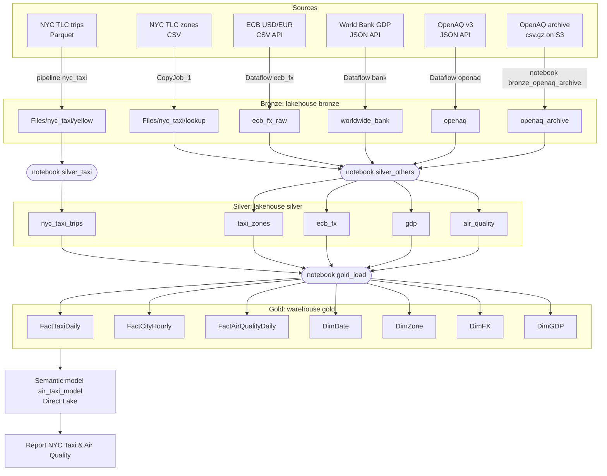

# Lineage

| Gold table | Silver | Bronze | Source |
|---|---|---|---|
| FactTaxiDaily | nyc_taxi_trips | Files/nyc_taxi/yellow | NYC TLC |
| FactCityHourly | nyc_taxi_trips, air_quality | Files/nyc_taxi/yellow, openaq, openaq_archive | NYC TLC, OpenAQ |
| FactAirQualityDaily | air_quality | openaq, openaq_archive | OpenAQ API and archive |
| DimZone | taxi_zones | Files/nyc_taxi/lookup | NYC TLC |
| DimFX | ecb_fx | ecb_fx_raw | ECB |
| DimGDP | gdp | worldwide_bank | World Bank |
| DimDate | - | - | generated in gold_load |
